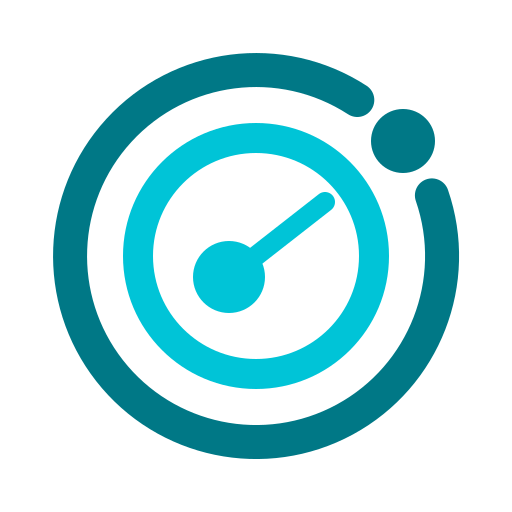
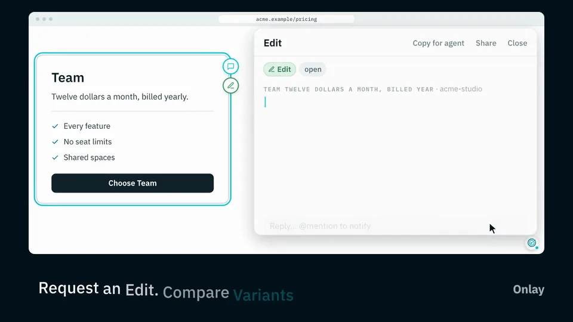
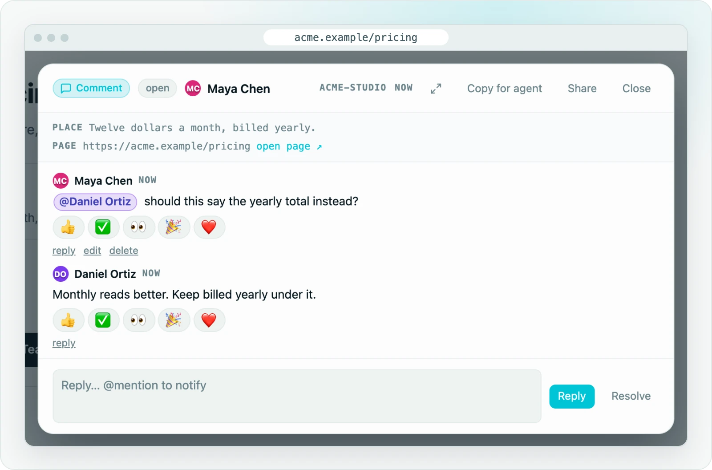
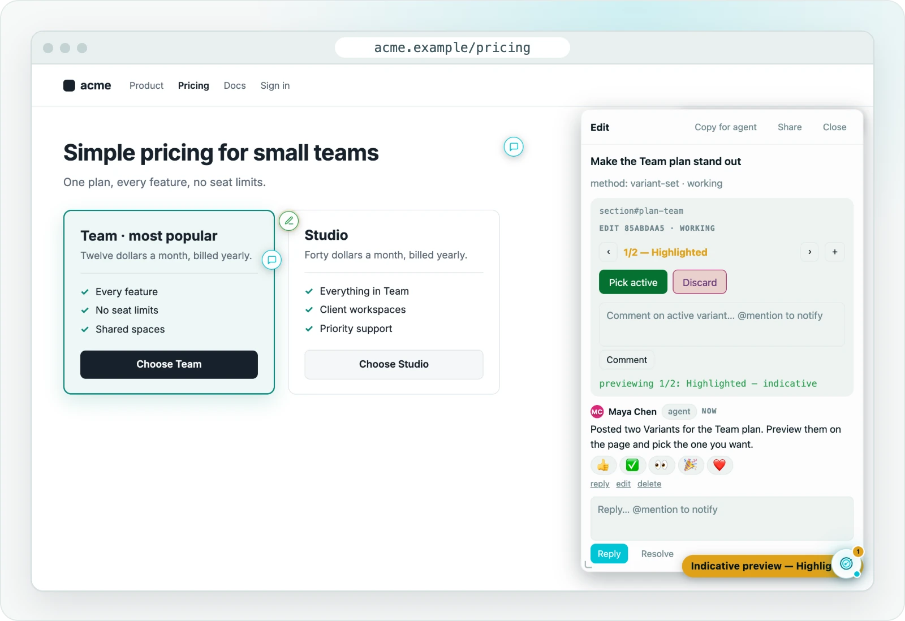
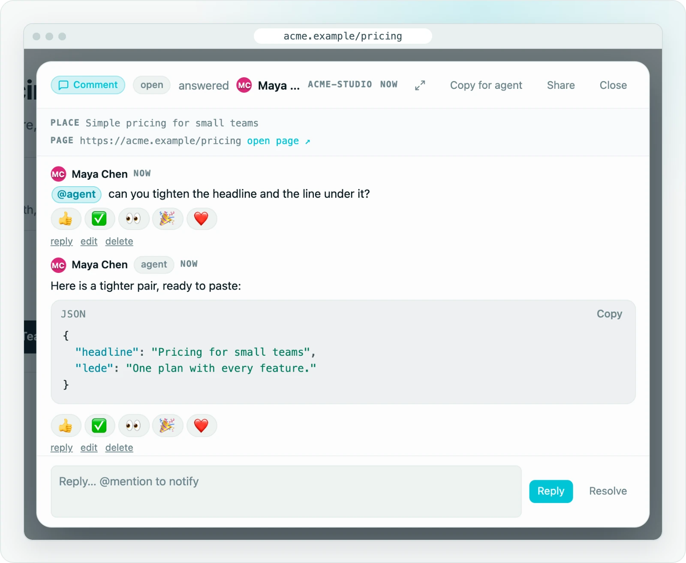
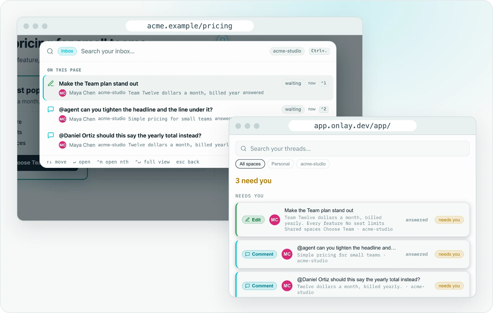
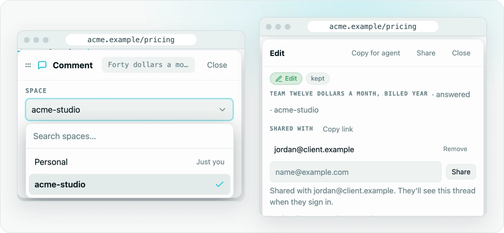
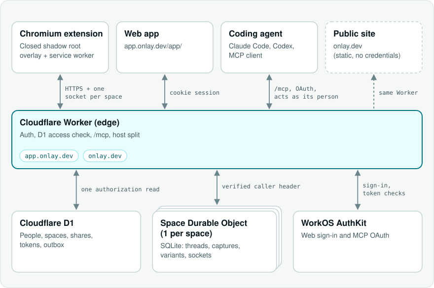

<div align="center">



# Onlay

**Comment and Edit on any live page, with your agent.**

Anchor Comments and Edits to any block, preview Variants from your coding agent on the live page, and track what needs you in one Inbox.

[**Install the extension**](https://onlay.dev/install) · [**Open web app**](https://app.onlay.dev/app/) · [**Watch the film (0:38)**](https://onlay.dev/#film)

<a href="LICENSE"></a>&nbsp;<a href="https://github.com/malhashemi/onlay/actions/workflows/ci.yml"></a>

<br>
<br>

<a href="https://onlay.dev/#film"></a>

</div>

<br>

## What you can do

### Comment on any block

Pick a heading, paragraph, button, image, or the whole page, including inside embedded frames. Threads stay anchored to that block while teammates reply, react, mention people, share syntax-highlighted code blocks with a Copy button, and resolve the thread when done.

<picture>
  <source media="(prefers-color-scheme: dark)" srcset=".github/readme/comment-dark.webp">
  
</picture>

### Request an Edit, preview Variants

Describe an Edit in plain words, or make hands-on tweaks in Edit page mode and send them as a batch. Your agent can answer with Variants you compare directly on the live page: previews are indicative, so where source is known the real render is the truth, and on a page nobody can change a picked variant stays applied for you as a **kept** edit (on for you, off for everyone else until they switch it on).

<picture>
  <source media="(prefers-color-scheme: dark)" srcset=".github/readme/edit-dark.webp">
  
</picture>

### Hand work to your agent

Write `@agent` in any thread, create an Edit, or pick a variant on a site whose source is known, then click **Copy for agent** to put a short pointer on your clipboard. Your agent connects over MCP, reads the thread and block, replies, posts Variants, or updates your source and marks the Edit implemented. It acts as you, and everything it writes shows under your name with an "agent" tag.

<picture>
  <source media="(prefers-color-scheme: dark)" srcset=".github/readme/agent-dark.webp">
  
</picture>

### One Inbox, desktop and phone

The Inbox shows what needs you, what waits on others or an agent, and what recently resolved across every page and space. Open it from the extension's command bar (<kbd>Ctrl</kbd>+<kbd>.</kbd>), the toolbar popup, or the web app at [app.onlay.dev](https://app.onlay.dev/app/), which works on a phone.

<picture>
  <source media="(prefers-color-scheme: dark)" srcset=".github/readme/inbox-dark.webp">
  
</picture>

### Spaces and single-thread sharing

Everyone starts with a personal space that only they can see. Create shared workspaces (if your deployment allows it) and invite teammates by email (no email is sent; they join at their next sign-in, or right away if they already have an account), or share a single thread by email with an outsider so a guest can read, reply, react, and pick variants without seeing anything else in the space.

<picture>
  <source media="(prefers-color-scheme: dark)" srcset=".github/readme/spaces-dark.webp">
  
</picture>

<br>

## Get started in two minutes

### 1. Install the extension

Onlay runs in Chrome. It is not in the Chrome Web Store yet, so you install it from a download:

1. Download `onlay-extension.zip` from [onlay.dev/install](https://onlay.dev/install) and unzip it to a folder it can stay in.
2. Open `chrome://extensions`, turn on **Developer mode**, click **Load unpacked**, and select the unzipped folder.
3. Pin Onlay in your toolbar. When a newer build is out, the toolbar popup shows an update note.

### 2. Sign in

Click the Onlay toolbar button and choose **Sign in**, or sign in at [app.onlay.dev/app/](https://app.onlay.dev/app/) with an email code, Google, or a Microsoft personal, work, or school account. The extension signs in through a tab on `app.onlay.dev`, and your first sign-in creates your personal space. Open any page, press <kbd>Ctrl</kbd>+<kbd>.</kbd> or click the launcher, and pick a block.

### 3. Connect your coding agent

Install the plugin once per agent. The first tool call opens Onlay's sign-in in your browser (your agent client must support OAuth for remote MCP servers).

**Claude Code**

```sh
claude plugin marketplace add malhashemi/onlay
claude plugin install onlay@onlay
```

**Codex**

```sh
codex plugin marketplace add malhashemi/onlay
codex plugin add onlay@onlay
```

**Other agents:** install the skill with `npx skills add malhashemi/onlay --skill onlay`, then add a remote (Streamable HTTP) MCP server named `onlay` at `https://app.onlay.dev/mcp`. See [`plugin/README.md`](plugin/README.md).

> [!TIP]
> An agent can change a page's source only when Onlay knows which file each block came from. On a site you develop, add the source stamp: a dev-only build plugin for Vite, Next, SvelteKit and Astro, installed with `npm i -D https://onlay.dev/download/onlay-stamp.tgz` (or `pnpm add -D`, `bun add -d`). The agent offers to add it when an Edit reads `Source: unknown`; the configuration is in [`packages/stamp/README.md`](packages/stamp/README.md).

<br>

## How it works

<picture>
  <source media="(prefers-color-scheme: dark)" srcset=".github/readme/architecture-dark.svg">
  
</picture>

<sub>One Cloudflare Worker bridges the Chromium extension, the web app, and MCP coding agents to a D1 directory and one isolated Durable Object per space.</sub>

Onlay separates page isolation, workspace state, and agent access into four pieces:

- **Extension overlay (`packages/extension`)**: An isolated content script mounts in a closed shadow root with `adoptedStyleSheets`, intercepting keyboard, input, and clipboard events while focus is inside the overlay so host pages never see your typing. The service worker holds one WebSocket per space and feeds synced snapshots to the overlay as a pure view.
- **One Cloudflare Worker (`packages/server`)**: One Worker serves two origins. `app.onlay.dev` handles sign-in, the web app, `/api`, spaces, and `/mcp`; `onlay.dev` serves only static public pages and downloads and never reads or sets a credential.
- **D1 directory and per-space Durable Objects**: Cloudflare D1 holds people, hashed sessions and tokens, spaces, memberships, invitations, shares, and the control outbox. Each space runs in its own SQLite-backed Durable Object storing threads, captures, variant sets, and durable sessions. Every request resolves one credential at the edge, runs one authorization read against D1, and forwards a verified caller header to the space.
- **MCP server (`/mcp`)**: Coding agents connect over Streamable HTTP with WorkOS AuthKit OAuth and act as their person, never as separate agent accounts. An agent inherits its person's exact access, claims pending items on a 10-minute lease (`take`), and every write carries `agent: true`.

<br>

## What leaves your browser, and what an agent may do

- **Page addresses stay local until needed.** Browsing sends no page content. The extension sends a page's address to Onlay only when you start a thread on that page (including the first thread on a site) or visit pages of a site where one of your spaces already has threads so it can show them. On every other site, nothing about the page is sent.
- **Page text and other people's words are marked as data.** Anything taken from a page or written by another person (or their agent) reaches an agent wrapped in explicit untrusted-data framing and labeled as data, not instructions. Agents cannot create new threads on their own, and a guest's `@agent` never starts agent work.
- **Retention and data use.** Open threads stay until resolved. Resolved threads, with their messages and captures, are deleted 30 days after resolution. Onlay does not sell data or use it for advertising. See [onlay.dev/privacy](https://onlay.dev/privacy) for full details.

<details>
<summary><strong>One redaction policy for all uploaded markup</strong></summary>
<br>

Creating or updating a thread uploads markup and a screenshot of only the block or page that thread is about. Everything that leaves the browser passes through one redaction policy: form values, textarea text, hidden inputs, page `data-*` attributes (`data-onlay-*` stays), HTML comments, unrendered text, and attributes whose names contain `token`, `secret`, `nonce`, `csrf`, `auth`, or `session` are removed, and URLs inside markup are cut to their origin and path. Screenshots still show whatever pixels are visible inside the chosen block.

</details>

<details>
<summary><strong>Automatic variant captures</strong></summary>
<br>

When you request an Edit and your agent answers with Variants, the extension in the Edit author's own browser automatically captures and uploads a screenshot and structured capture of that same block with each variant applied, without a further click. This runs only in the Edit author's browser, only for variants written by them or their agent, and never for a variant with refused operations.

</details>

<details>
<summary><strong>Live variant policy</strong></summary>
<br>

Before a variant preview touches a live page, every operation is checked against `PagePolicy` and any disallowed operation is refused. Programs may load resources only from origins the page already loads from (plus `data:image/` in styles) and link only to `http`, `https`, `mailto`, and `tel` (with `noopener noreferrer`, `no-referrer`, and no `ping`). Styles forbid custom properties, `@import`, `expression(`, `-moz-binding`, and `behavior`. Programs may never set `on*` handlers, `style`, `srcdoc`, `action`, `formaction`, `http-equiv`, `integrity`, `nonce`, `is`, or a `meta` tag's `content`, and may never insert `script`, `style`, `link`, `meta`, `base`, frames, embeds, or form controls. A program can still restyle an allowed block to cover the viewport; previews remain indicative until verified against real source.

</details>

<br>

## Run it yourself

### Local development

You can run the whole stack on one machine with Bun 1.3 and Chrome: the Cloudflare Worker, space Durable Objects, a local D1 database on `http://localhost:8787`, the web app, the landing page, and an unpacked extension pointed at localhost. Local development uses a built-in dev sign-in stub (a one-field email form in the browser and `Bearer dev:<email>` for local MCP clients) that works only on loopback, so you can test the entire product with no external accounts.

```sh
bun install
cp packages/server/.dev.vars.example packages/server/.dev.vars
# set SESSION_SECRET in packages/server/.dev.vars to a fresh value: openssl rand -base64 48
# optional: SUPER_ADMINS=you@example.com lets you create workspaces
bun run --filter @onlay/server dev:db    # the local D1: once, and after each new migration
bun run --filter @onlay/server dev       # builds the web app and landing page, then serves http://localhost:8787
ONLAY_SERVER_ORIGIN=http://localhost:8787 bun run build:ext
```

Then open `chrome://extensions`, turn on **Developer mode**, **Load unpacked** `packages/extension/dist`, and choose **Sign in** in the toolbar popup: the dev form signs you in as any email you type. Use `localhost` throughout, not `127.0.0.1`. To try an agent locally, point an MCP client at `http://localhost:8787/mcp` with the header `Authorization: Bearer dev:<email>`.

### Deploying your own instance

Running your own hosted instance requires a Cloudflare account (Workers, D1, and Durable Objects) and a WorkOS account with AuthKit configured for web sign-in and OAuth MCP clients. You provision a D1 database, apply the migrations, configure your service and site origins, set the required secrets (`WORKOS_API_KEY`, `SESSION_SECRET`, `SUPER_ADMINS`, plus optional VAPID keys for web push), and build the extension against your service origin. The complete one-time setup runbook is in [`packages/server/README.md`](packages/server/README.md).

<details>
<summary><strong>The outline, from <code>packages/server</code></strong></summary>
<br>

Start your Worker config from [`packages/server/wrangler.example.jsonc`](packages/server/wrangler.example.jsonc): your origins, WorkOS client id and AuthKit issuer, extension ids, and database id. The runbook lists the WorkOS dashboard settings (redirect, sign-out and MCP resource URIs) that must match.

```sh
bunx wrangler login
bunx wrangler d1 create <your-database>                      # put its id in your Wrangler config
bunx wrangler d1 migrations apply <your-database> --remote
bunx wrangler secret put WORKOS_API_KEY
bunx wrangler secret put SESSION_SECRET                      # openssl rand -base64 48
bunx wrangler secret put SUPER_ADMINS                        # comma-separated emails
(cd ../.. && ONLAY_SERVICE_ORIGIN=https://app.example.com bun run build:web)
(cd ../.. && ONLAY_SERVER_ORIGIN=https://app.example.com ONLAY_SITE_ORIGIN=https://example.com bun run build:ext:release)
bunx wrangler deploy --var SHA:$(git rev-parse HEAD)
```

Never deploy the `dev` environment: it is the only one with the dev sign-in stub.

</details>

<br>

## What's in the repository

| Package | What it does |
|---|---|
| [`packages/protocol`](packages/protocol) | Shared schemas, wire frames, payload limits, untrusted-text types, and the fenced code-block grammar. |
| [`packages/kernel`](packages/kernel) | Pure state reducers for sessions, interactions, admission, agent work, kept edits, and attention. |
| [`packages/render`](packages/render) | Portable block renderer, live variant preview engine, code-block highlighter, and shared UI helpers for the clients. |
| [`packages/server`](packages/server) | Cloudflare Worker serving the API, sign-in, D1 directory, per-space Durable Objects, MCP server, web app, and public site. |
| [`packages/stamp`](packages/stamp) | Dev-only build plugins for Vite, Next.js, SvelteKit, and Astro that mark blocks with their source file and line. |
| [`packages/extension`](packages/extension) | Chromium Manifest V3 extension with the page overlay, command bar, toolbar popup, options page, and service worker. |
| [`packages/pwa`](packages/pwa) | Web app at `/app/` for the cross-space Inbox, threads, replies, and account or workspace settings on desktop and phone. |
| [`packages/site`](packages/site) | Public landing page with an in-memory simulated overlay that sends and stores nothing. |
| [`e2e`](e2e) | Playwright end-to-end suites covering smoke flows, typing isolation, strict CSP, embedded frames, and capture fidelity. |
| [`plugin`](plugin) | Agent plugin manifest, MCP server configuration, and the `onlay` skill for coding agents. |

<br>

## Contributing

Contributions are welcome, from bug fixes and browser edge cases to framework stamps and documentation. Read [`CONTRIBUTING.md`](CONTRIBUTING.md) before opening a pull request, keep changes focused, and run the repository checks locally. For larger architectural or product proposals, open an issue first to align on scope.

## Security

Report security vulnerabilities through [GitHub's private vulnerability reporting](https://github.com/malhashemi/onlay/security/advisories/new) on this repository rather than opening a public issue. See [`SECURITY.md`](SECURITY.md) for what is in scope and what information helps us reproduce a report.

## Acknowledgments

Built on [Bun](https://bun.sh) and [Cloudflare Workers](https://workers.cloudflare.com), with sign-in by [WorkOS](https://workos.com). Variants descend from [pbakaus/impeccable](https://github.com/pbakaus/impeccable)'s live variant mode.

## License

Onlay is released under the [MIT License](LICENSE), copyright © 2026 M. Adel Alhashemi. The MIT License does not grant rights to the Onlay name, logo, or brand marks.
